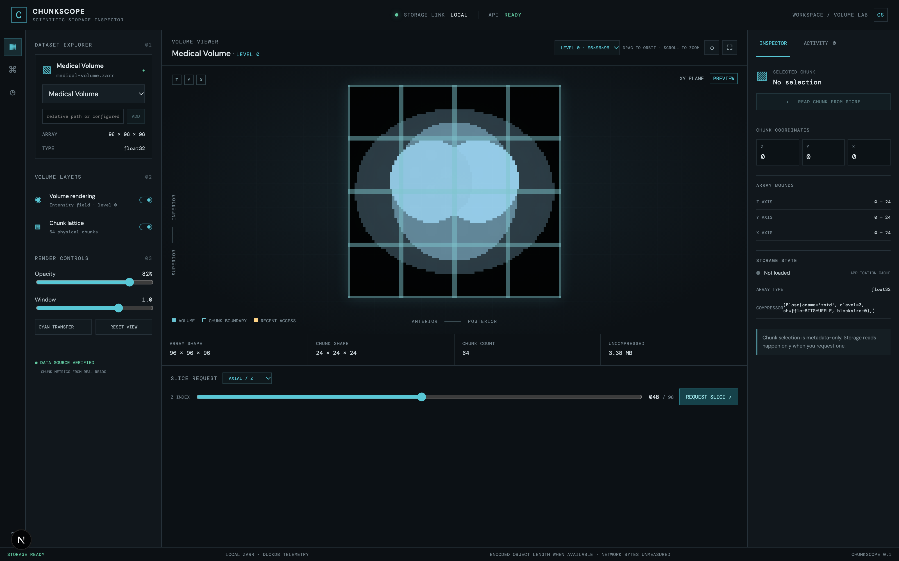
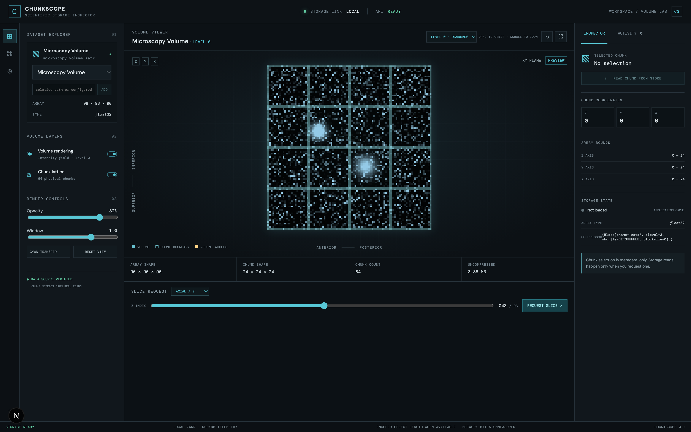
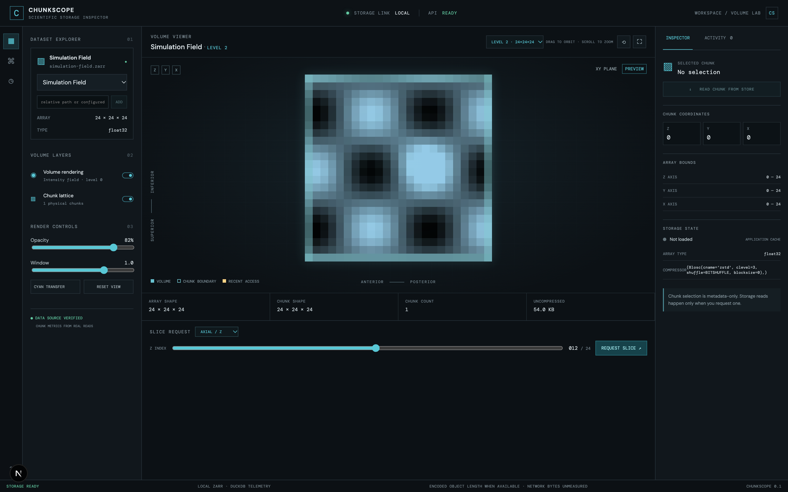
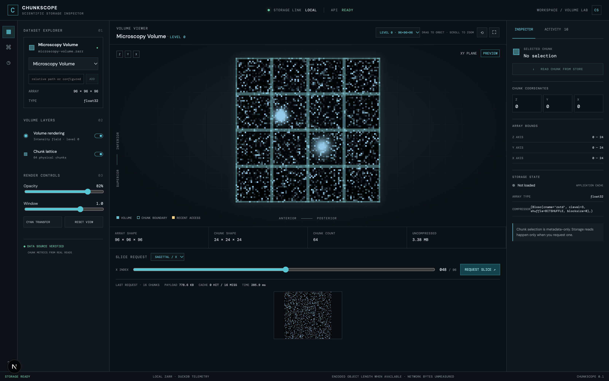
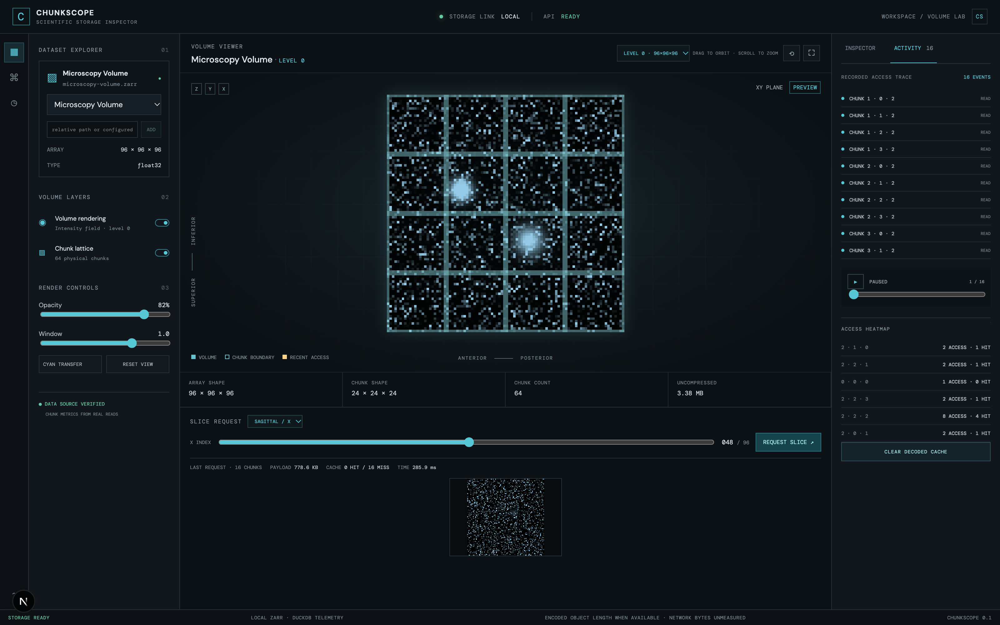

# ChunkScope

ChunkScope is a scientific storage inspector for Zarr datasets. It combines a bounded 3D volume preview with an interactive chunk lattice, slice reads, cache inspection, and persisted access telemetry.



The local sample is a real Zarr v2 store. Its bounded preview is rendered in the browser; chunk and slice requests go through the API and produce cache and access events.

## Features

- Three deterministic Zarr v2 sample datasets are generated automatically when the API starts with an empty data directory.
- The WebGL2 volume renderer displays the selected dataset's bounded preview and chunk boundaries. Drag to orbit and use the wheel to zoom.
- The chunk lattice and coordinates derive from the selected array's shape and chunk dimensions. Selecting a chunk does not read it; **Read chunk** performs the storage request.
- Numeric root arrays can be selected as multiscale levels. Slice requests read the intersecting chunks and return the assembled plane.
- A process-local decoded-chunk LRU and DuckDB record cache state and access events. The access heatmap and playback use those recorded events.
- Local Zarr v2 DirectoryStore chunk object lengths are measured when available. Remote object lengths and unsupported store layouts are reported as unknown.

## Screenshots

These 3200 × 2000 captures come from the running local app. They show different generated datasets, a coarse multiscale level, a sagittal slice request, and the access timeline.

### Microscopy sample



The generated microscopy volume has a sparse field of bright structures, distinct from the denser medical phantom in the overview.

### Coarse simulation level



This view selects level 2 of the simulation field: a 24 × 24 × 24 array represented by one physical chunk.

### Sagittal slice request



The X=48 sagittal request reads the 16 chunks intersecting the plane. This capture shows 16 cache misses and 778.6 KB of encoded chunk payload.

### Access telemetry



The Activity pane shows the recorded chunk events, playback controls, and per-chunk access heatmap.

## Requirements

Install Node.js, pnpm, Python 3.11 or newer, and uv. Dependency versions are resolved in `pnpm-lock.yaml` and `uv.lock`.

Install dependencies and start the API and web app in separate terminals:

```sh
pnpm install --frozen-lockfile
uv sync --locked --extra test
uv run uvicorn apps.api.app.main:app --reload --port 8000
```

```sh
pnpm dev
```

Open <http://localhost:3000>. The API generates sample datasets on first startup. To generate them explicitly, run `uv run python scripts/generate_samples.py`.

## Configuration

The API reads configuration from environment variables. `.env.example` lists the supported settings; copy the needed values into the shell environment before starting the services. The API does not load that file automatically.

`CHUNKSCOPE_DATA_DIR` defaults to `data/volumes`, and local dataset registration is confined to this directory. `CHUNKSCOPE_DB` defaults to `data/telemetry.duckdb`. Request size and cache limits are configurable in `.env.example`.

To register a local Zarr store located under the data directory:

```sh
curl -X POST http://localhost:8000/api/datasets \
  -H 'content-type: application/json' \
  -d '{"path":"my-volume.zarr","name":"My volume"}'
```

S3-compatible storage is optional. Configure `S3_BUCKET`, optionally `S3_PREFIX`, and the server-side endpoint, region, TLS, and credentials as required by the provider. Register a URI such as `s3://my-bucket/my-prefix/scan.zarr`. The API restricts access to the configured bucket and prefix; credentials are not sent to the browser.

## Measurement definitions

- **Cache hit:** a decoded chunk was found in the API process's in-memory LRU. No array read is issued for that chunk.
- **Cache miss:** a decoded chunk was absent and requested through Zarr.
- **Stored bytes:** for a local Zarr v2 directory store, the encoded chunk object's file length. This excludes filesystem overhead, metadata, and protocol traffic. Cache hits report zero newly read bytes. For remote stores and layouts where the object length cannot be measured, the value is `null`.
- **Implicit fill:** for supported local Zarr v2 directory stores, the expected chunk key is absent and Zarr supplies the array fill value. This does not treat an absent key as corruption.
- **Duration:** application wall-clock time for cache lookup, array access, decoding, and event persistence. Slice duration also includes plane assembly and normalization. It is not a direct measure of provider latency or physical disk/network I/O.
- **Decoded bytes:** the in-memory NumPy block size, not its encoded storage size.

## Development

Run the backend tests and frontend checks with:

```sh
uv run pytest
pnpm typecheck
pnpm build
```

See [docs/ARCHITECTURE.md](docs/ARCHITECTURE.md) for storage behavior and current support boundaries. Contributions are welcome; see [CONTRIBUTING.md](CONTRIBUTING.md).

For this showcase run, all 9 backend tests passed, as did the TypeScript typecheck and Next.js production build. In the browser, I exercised the volume preview, a slice request (16 chunk reads), chunk selection, and a cache hit. Live S3 interoperability is not covered by these checks.

## License

ChunkScope is distributed under the [MIT License](LICENSE).
